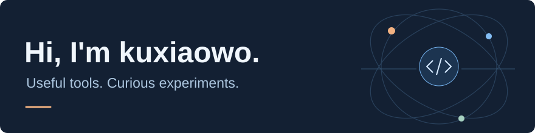
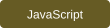

  <picture>
    <source media="(max-width: 600px)" srcset="./assets/header-compact.svg">
    
  </picture>

  <strong>AI applications · Web tools · Game mods</strong>

  I build software for the things I use — from AI desktop companions and searchable media libraries 
  to campus platforms and game mods. Mostly Python, with C# / .NET for Kitten Space Agency.

  <a href="mailto:zhengxinpang0@gmail.com">Email</a> &nbsp;·&nbsp;
  <a href="https://github.com/kuxiaowo?tab=repositories">Explore my repositories</a>

  
  
  
  
   
  
  
  
  

## Selected projects

Tools I build and maintain, across a few different interests.

| Project | What it does | Stars |
| :--- | :--- | ---: |
| **[AIpet · Murasame](https://github.com/kuxiaowo/AIpet-Murasame)** | An AI desktop companion with local or cloud models, speech interaction, and optional screen awareness. Built on [MurasamePet](https://github.com/LemonQu-GIT/MurasamePet). | [★ 79](https://github.com/kuxiaowo/AIpet-Murasame/stargazers) |
| **[ASR Bridge](https://github.com/kuxiaowo/wechat-asr-bridge)** | A Windows app that brings WeChat, WeType, and Doubao speech recognition behind a local, OpenAI-compatible transcription API. | [★ 57](https://github.com/kuxiaowo/wechat-asr-bridge/stargazers) |
| **[LocalMedia](https://github.com/kuxiaowo/Local-Media-AI-Library)** | A local photo and video library with AI descriptions and natural-language search. Original media stays read-only. | [★ 6](https://github.com/kuxiaowo/Local-Media-AI-Library/stargazers) |
| **[NetHub](https://github.com/kuxiaowo/NetHub-Campus-Wiki)** | Campus project discovery and resource sharing, with a separate [Accounts](https://github.com/kuxiaowo/NetHub-Accounts) service for shared sign-in. | [★ 10](https://github.com/kuxiaowo/NetHub-Campus-Wiki/stargazers) |
| **[KSA Babel · 喵语塔](https://github.com/kuxiaowo/KSA-Babel)** | A multilingual localization framework for Kitten Space Agency, with language packs, an in-game language menu, and shared fonts. Also available as [KSA Chinese](https://github.com/kuxiaowo/KSA-CHINESE). | [★ 0](https://github.com/kuxiaowo/KSA-Babel/stargazers) |
| **[AC / ACC → Forza Bridge](https://github.com/kuxiaowo/AC-Forza-Telemetry-Bridge)** | Connects Assetto Corsa and ACC shared-memory telemetry to dashboards that understand the Forza Horizon Dash UDP format. | [★ 2](https://github.com/kuxiaowo/AC-Forza-Telemetry-Bridge/stargazers) |

<!-- stats-date:start -->
Star counts as of 2026-11-02; each count refers to the linked repository.
<!-- stats-date:end -->

## What connects these projects

- **AI in everyday tools** — desktop companions, voice input, and finding the right photo or video.
- **Useful web applications** — shared sign-in, campus resources, and project discovery.
- **Games worth tinkering with** — localization for spaceflight sims and telemetry for racing sims.

## GitHub stats

  <picture>
    <source media="(max-width: 600px)" srcset="./assets/github-stats-compact.svg">
    
  </picture>

## Get in touch

Have a question, an idea, or a bug to report? Open an issue in the relevant repository, or email **[zhengxinpang0@gmail.com](mailto:zhengxinpang0@gmail.com)**.

Built around real projects, and always a work in progress.

